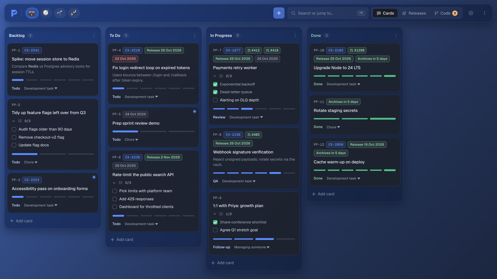
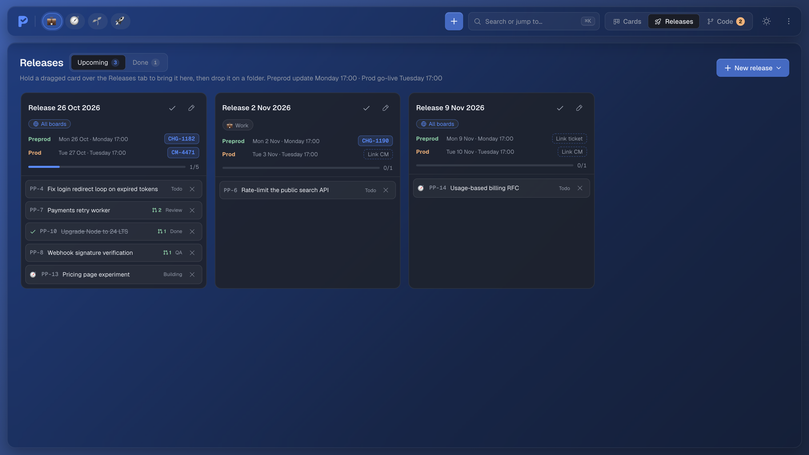
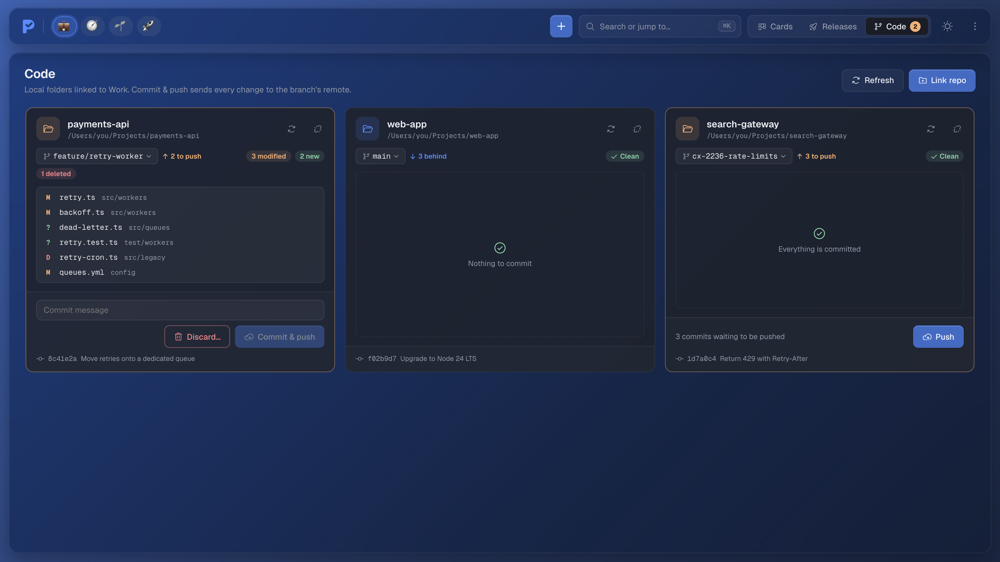

<p align="center">
  <picture>
    <source media="(prefers-color-scheme: dark)" srcset="docs/logo-dark.png">
    
  </picture>
</p>

<h1 align="center">PeteyPlan</h1>

<p align="center">
  A fast, self-hosted Kanban board for tracking your own work.<br>
  Multiple boards, checklists, release folders, a local git panel and an MCP server, in one small Docker container.
</p>

<p align="center">
  <a href="#install-with-docker">Install</a> ·
  <a href="#updating">Update</a> ·
  <a href="#features">Features</a> ·
  <a href="#mcp-server">MCP</a> ·
  <a href="#http-api">API</a>
</p>

<p align="center">
  <picture>
    <source media="(prefers-color-scheme: light)" srcset="docs/screenshot-light.png">
    
  </picture>
</p>

---

You need [Docker](https://docs.docker.com/get-docker/) with Docker Compose (included in Docker Desktop).
For local dev and tests you need [Node 24+](https://nodejs.org/) — the test suite imports TypeScript directly via type stripping, which needs Node 24 (`nvm use` picks it up from `.nvmrc`).

```bash
git clone https://github.com/genericmilk/peteyplan.git
cd peteyplan
npm ci
npm test
cp .env.example .env   # optional: set PORT or CODE_DIR
docker compose up -d --build
```

Open **[http://localhost:3000](http://localhost:3000)** (or your `PORT`).

On first start PeteyPlan creates a SQLite database in the `peteyplan-data` Docker volume and seeds a **Default Board** with **Backlog**, **To Do**, **In Progress** and **Done** columns. The container restarts automatically with Docker and has a built-in health check.

<details>
<summary><strong>Run on a different port</strong></summary>

Set `PORT` in `.env` (see `.env.example`):

```bash
PORT=8080 docker compose up -d
```

Then apply it with `docker compose up -d`.
</details>

## Updating

Your board lives in the Docker volume, not the image, so updating never touches your data.

```bash
cd peteyplan
git pull
docker compose up -d --build
```

Database changes (new columns such as checklists) are applied automatically when the new version starts.

<details>
<summary><strong>Back up before updating (recommended)</strong></summary>

Snapshot the data volume to a file in the current folder:

```bash
docker compose stop
docker run --rm -v peteyplan_peteyplan-data:/data -v "$PWD":/backup alpine \
  tar czf /backup/peteyplan-backup.tgz -C /data .
docker compose start
```

Restore it (this replaces the current board):

```bash
docker compose stop
docker run --rm -v peteyplan_peteyplan-data:/data -v "$PWD":/backup alpine \
  sh -c 'rm -rf /data/* && tar xzf /backup/peteyplan-backup.tgz -C /data'
docker compose start
```
</details>

<details>
<summary><strong>Roll back to an earlier version</strong></summary>

```bash
git log --oneline            # find the commit you want
git checkout <commit>
docker compose up -d --build
```

Return to the latest version with `git checkout main && git pull`.
</details>

### Everyday commands

| Task | Command |
| ---- | ------- |
| Stop (keeps your board) | `docker compose down` |
| Start again | `docker compose up -d` |
| View logs | `docker compose logs -f` |
| **Delete everything**, including your board | `docker compose down -v` |

### Troubleshooting the Docker build

See the full error first, since the lines just above the failing step say what went wrong:

```bash
docker compose build --no-cache --progress=plain 2>&1 | tail -40
```

<details>
<summary><strong><code>apt-get</code> fails with exit code 100</strong></summary>

This only happens with the [git override](#git-integration) (`docker-compose.git.yml`). That's the one build that installs git, ssh and ca-certificates from the Debian mirrors (`deb.debian.org`) for the **Code** view. The plain `docker compose up -d --build` doesn't use apt, so it can't hit this. Exit code 100 means apt couldn't download or verify the packages. It isn't specific to x64, Apple silicon or Windows. Look for one of these just above the error:

| Message | Cause | Fix |
| ------- | ----- | --- |
| `Temporary failure resolving 'deb.debian.org'` | Docker can't resolve DNS | Restart Docker Desktop. On a VPN, set a DNS server under **Settings → Docker Engine**, e.g. `"dns": ["8.8.8.8"]` |
| `Could not connect`, `Connection timed out` or `403` | A proxy or firewall is in the way | Set the proxy under **Settings → Resources → Proxies** in Docker Desktop, or pass it to the build (below) |
| `403 authenticationrequired` from `deb.debian.org` over plain HTTP | An intercepting corporate proxy rewriting HTTP | Drop the proxy's CA as `.corp-ca.pem` (see [Git integration](#git-integration)) and rebuild — apt then uses HTTPS mirrors |
| `Hash Sum mismatch` or `Release file … is not valid yet` | A mirror was mid-update, or the clock is wrong | Wait a few minutes and rebuild with `--no-cache`. Check the machine's date and time |
| `Unable to locate package` | `apt-get update` didn't get a package list | Same as the connection fixes above |

Pass a proxy to the build:

```bash
docker compose -f docker-compose.yml -f docker-compose.git.yml build --no-cache \
  --build-arg HTTP_PROXY=$HTTP_PROXY \
  --build-arg HTTPS_PROXY=$HTTPS_PROXY \
  --build-arg NO_PROXY=$NO_PROXY
docker compose -f docker-compose.yml -f docker-compose.git.yml up -d
```

You can't use the Code panel from Docker until this build works. The plain `docker compose up -d --build` still runs PeteyPlan in the meantime.

On Windows, set the variables first in PowerShell (`$env:HTTP_PROXY = "http://proxy.example.com:8080"`), or put the values straight into the command.
</details>

<details>
<summary><strong><code>npm ci</code> fails with <code>SELF_SIGNED_CERT_IN_CHAIN</code>, <code>ETIMEDOUT</code> or <code>ECONNRESET</code></strong></summary>

The build couldn't reach the npm registry. That's usually the same proxy problem: pass the proxy build args above. `SELF_SIGNED_CERT_IN_CHAIN` means a work network is inspecting HTTPS traffic, so the build needs your company's root certificate. Ask IT for it, or build on a network without inspection.
</details>

<details>
<summary><strong>Errors mentioning <code>\r</code>, <code>$'\r': command not found</code> or "unknown instruction" on Windows</strong></summary>

Git converted the files to Windows line endings when it cloned them, which breaks commands that span several lines in the `Dockerfile`. Switch to Unix line endings and check the files out again:

```bash
git config core.autocrlf input
git rm --cached -r -q .
git reset --hard
docker compose build --no-cache
```

`git reset --hard` throws away uncommitted changes in this folder, which is fine on a plain clone of PeteyPlan.
</details>

<details>
<summary><strong>Port 3000 is already in use</strong></summary>

Something else is listening on 3000. Run PeteyPlan on another port (see [Run on a different port](#install-with-docker)), or find what's using it with `lsof -i :3000` on macOS/Linux or `netstat -ano | findstr :3000` on Windows.
</details>

## Features

**Boards and cards**
- Multiple boards, each with its own emoji and colour. Click a pill in the top bar to switch, or hover a pill while dragging to carry a card or column across.
- Hover the board list or focus a pill to reveal every name. Inactive pills are greyscale, showing 50% colour on hover. When the list overflows, wheel up scrolls left and wheel down scrolls right, with the scrollbar hidden.
- Drag-and-drop columns and cards. Cards dropped into **Done** are marked complete and auto-archive after 5 days.
- Every card gets a stable reference like `PP-12` that works in the UI, API and MCP tools.
- **Copy link** in a card's dialog puts a share link on your clipboard to send over chat. The card itself is packed into the link (after the `#`, so it never reaches a server), and opening it in anyone's PeteyPlan offers to add a copy to their chosen board and column. Links point at your own address (usually `localhost:3000`), so someone running on a different port has to change that part.
- Optional description (Markdown), Jira key and due date. Sooner due dates float to the top; overdue and due-today dates are highlighted.
- **Pull requests**: paste PR links into a card's dialog (GitHub, GitLab, Bitbucket, Azure DevOps or any link). They show as `#123` chips on the card that open the PR, and as a count on the card's row in its release. Search finds cards by PR number or repo.
- **Checklists** inside cards: tick items on the card, quick-add from the card footer, or edit and reorder them in the card dialog.
- Work types with their own progress stages, shown as a stage track. Hover a segment to see the stage, click to set it. Development task, Chore and Managing someone come built in. Rename, reorder, add or remove types and their stages under **Settings → Work types**. Every type runs from Todo to Done; cards on a removed stage step back to the one before it, and cards of a removed type move to the first type.
- **Releases** group cards into a weekly release with preprod and prod Jira tickets. A release is shared by every board by default, so it can collect cards from all of them, or it can be pinned to one board. Switch to **Releases** in the top bar to see every folder full-screen. To add a card, hold it over the **Releases** tab while dragging and drop it on a folder, or pick one with the **Release** selector in the card dialog. Each folder shows its progress, flags **Past due** once prod go-live has passed, and keeps cards even after they archive. **Mark done** moves it to the **Done** tab and locks its cards, and can optionally mark every unfinished card Done too. **Reopen** brings it back.
- **Code**: link one or more local project folders to a board, then switch to **Code** in the top bar to see each one's branch, changed files and unpushed commits. Click the branch to switch, check out a remote branch, create a new one, or fetch. When the branch is behind its remote, click **N behind** to pull. It only fast-forwards, so if both sides have new commits it stops and leaves the merge to you. Add folders with **+ → Link repo**: the folder browser tags git repos and marks the ones already linked (on Windows it lists your drives and WSL distros). **Commit & push** stages everything and pushes in one click, and **Discard…** throws away local edits, with a checkbox for also deleting new untracked files. See [Git integration](#git-integration).
- Soft-delete to an archive you can restore from. An unread dot marks cards nobody has opened yet.

<p align="center">
  <picture>
    <source media="(prefers-color-scheme: light)" srcset="docs/screenshot-releases-light.png">
    
  </picture>
  <picture>
    <source media="(prefers-color-scheme: light)" srcset="docs/screenshot-code-light.png">
    
  </picture>
</p>

**Built for speed**
- Add cards inline at the bottom of a column: type, press <kbd>Enter</kbd>, keep going.
- The **+** beside search follows the view: a card, column or board on **Cards**, a release on **Releases**, and a linked repo on **Code**.
- Press <kbd>⌘K</kbd> on Mac, <kbd>Ctrl</kbd>+<kbd>K</kbd> elsewhere, or <kbd>/</kbd> to open the command palette. It searches cards on every board (archived ones too) by title, ref, description, Jira key, column, stage or checklist item. It also finds boards and columns, and runs actions such as new card, new column, archive, releases, theme and settings. Pick **Filter this board** to keep only matching cards on screen, and clear the filter from the chip in the top bar.
- Jira keys like `CX-1831` link straight to the issue wherever they appear.

**Looks the way you like**
- Frosted-glass interface themed by the active board: its colour lights the backdrop and tints the buttons, links, progress, logo and tab icon (shades are adjusted automatically so text stays readable).
- Switching boards is a quick slide that takes about 100ms however many boards it passes.
- **Settings → Appearance**: Day, Night or System theme (or the sun/moon button), Glass or Solid surfaces, transition speed, whether scrolling past the first or last column switches boards, and comfortable or compact density. Respects your OS reduced-motion and reduced-transparency settings.

## Git integration

The **Code** view runs the `git` installed on the machine that runs the PeteyPlan server. It uses your own git config and credentials, never prompts, and only touches folders you've linked.

- **Running directly** (`npm run dev`, or `npm run build && node .output/server/index.mjs`) works out of the box: link any folder on your machine.
- **Windows**: Git for Windows handles normal folders. Folders inside WSL (`\\wsl.localhost\<distro>\…`, listed under **WSL** in the folder browser) run the distro's own git through `wsl.exe`, so they use your Linux git config and SSH keys.
- **Docker** can't see your folders by default. Start it with the git override, which mounts your home directory (or `CODE_DIR` from `.env.example`) at the same path plus `~/.ssh`, `~/.gitconfig` and `~/.git-credentials` (read-only), and binds the app to `127.0.0.1` only:

  ```bash
  docker compose -f docker-compose.yml -f docker-compose.git.yml up -d --build
  ```

  Only this override installs git into the image, so the plain `docker compose up` never needs the Debian package mirrors. If that build fails at `apt-get` with exit code 100, see [Troubleshooting the Docker build](#troubleshooting-the-docker-build).

  HTTPS remotes use the mounted `~/.git-credentials` (your name/email come along too; host-only settings like the `gh` credential helper or a proxy are ignored). SSH remotes work with keys that have no passphrase. The folder browser starts at your home directory.

  Behind an intercepting corporate proxy the plain-HTTP Debian mirrors fail. Drop the proxy's CA as `.corp-ca.pem` (gitignored, never committed) and rebuild — the image then installs git over HTTPS:

  ```bash
  cp /path/to/proxy-ca.pem .corp-ca.pem
  docker compose -f docker-compose.yml -f docker-compose.git.yml up -d --build
  ```

Commit & push, Push, Pull and Discard act on your real working copy. Anyone who can reach the app can use them, so don't expose PeteyPlan beyond your own machine while folders are linked. Unlinking a folder never touches its files.

## MCP server

[`mcp-server.js`](mcp-server.js) lets AI agents read and update your board. It runs over stdio and talks to the running app over HTTP, so start PeteyPlan first.

| Tools | |
| ----- | - |
| Boards | `get_boards`, `get_board`, `get_columns`, `get_cards`, `get_work_types` |
| Cards | `add_card`, `update_card`, `delete_card`, `move_card` |
| Columns | `add_column`, `rename_column`, `delete_column`, `clear_column_cards`, `reorder_columns` |

Board reads, `move_card`, `add_column` and `reorder_columns` take an optional `boardId` (omit it for the default board). `add_card` and `update_card` accept a `checklist` and `pullRequests` (URLs), and take `kind` and `progress` as an id or name from `get_work_types`. Set `PETEYPLAN_API_URL` if the app isn't at `http://localhost:3000`.

<details>
<summary><strong>OpenCode</strong></summary>

```json
{
  "mcp": {
    "peteyplan": {
      "type": "local",
      "command": ["node", "mcp-server.js"],
      "enabled": true,
      "env": { "PETEYPLAN_API_URL": "http://localhost:3000" }
    }
  }
}
```

A ready-made config lives in [`opencode.json`](opencode.json).
</details>

<details>
<summary><strong>Cursor, Claude Code and other MCP clients</strong></summary>

Add a stdio server that runs `node /path/to/peteyplan/mcp-server.js` with `PETEYPLAN_API_URL` set to your running app. Run `npm install` in the repo once so the MCP SDK is available.
</details>

## HTTP API

Card routes accept either a card ID or a `PP-n` ref. Routes marked † take an optional `?boardId=` and default to the default board.

<details>
<summary><strong>Route reference</strong></summary>

| Method | Route | Body |
| ------ | ----- | ---- |
| GET | `/api/boards` | |
| POST | `/api/boards` | `{ name, emoji?, color? }` |
| PATCH | `/api/boards/:id` | `{ name?, emoji?, color? }` |
| DELETE | `/api/boards/:id` | Deletes the board and its contents (default board protected) |
| POST | `/api/boards/:id/items` | `{ fromBoardId, type: "card" \| "column", itemId, targetColumnId?, targetPosition? }` |
| GET | `/api/board` † | |
| POST | `/api/columns` † | `{ title }` |
| PATCH | `/api/columns/:id` | `{ title }` |
| DELETE | `/api/columns/:id` | |
| DELETE | `/api/columns/:id/cards` | Archives every card in the column |
| POST | `/api/columns/reorder` † | `{ orderedIds }` |
| GET | `/api/search` | Every column and card on every board, archived cards included (powers the command palette) |
| GET | `/api/kinds` | Work types and their stages |
| PUT | `/api/kinds` | `{ kinds: [{ id?, label, stages: [{ id?, label }] }] }`, replacing the whole list. `stages` are the ones between Todo and Done |
| POST | `/api/cards` | `{ columnId, title, description?, jiraKey?, dueBy?, kind?, progress?, checklist?, pullRequests? }` |
| PATCH | `/api/cards/:id` | `{ title?, description?, jiraKey?, dueBy?, kind?, progress?, checklist?, pullRequests?, releaseId? }` |
| DELETE | `/api/cards/:id` | Soft-archives the card |
| POST | `/api/cards/reorder` | `{ columnId, orderedIds }` |
| GET | `/api/archive` † | |
| POST | `/api/archive/restore` | `{ cardId, columnId? }` |
| DELETE | `/api/archive/:id` | Permanently deletes an archived card |
| GET | `/api/releases` † | Shared releases plus those pinned to the board; open first, then done |
| POST | `/api/releases` † | `{ title?, weekStart?, preprodKey?, prodKey?, boardScope? }`. `boardScope` is a board ID, or `null` (default) for every board |
| PATCH | `/api/releases/:id` | `{ title?, weekStart?, preprodKey?, prodKey?, boardScope?, done?, completeCards? }`. Pinning to a board drops cards from other boards |
| DELETE | `/api/releases/:id` | Cards stay on the board |
| POST | `/api/releases/:id/cards` | `{ cardId }`. 409 when the release is done or pinned to another board |
| DELETE | `/api/releases/:id/cards/:cardId` | |
| GET | `/api/git` | `{ available, version }` |
| GET | `/api/folders?path=` | Subfolders of `path` (default: home), flagging git repos, plus places to start from (home, drives, WSL distros) |
| GET | `/api/boards/:id/repos` | Linked folders with branch, ahead/behind and changed files |
| POST | `/api/boards/:id/repos` | `{ path }`, an absolute path inside a git repository |
| DELETE | `/api/repos/:id` | Unlinks the folder (files stay on disk) |
| GET | `/api/repos/:id/status` | |
| POST | `/api/repos/:id/commit` | `{ message, push? }`. Stages everything first |
| POST | `/api/repos/:id/push` | Sets an upstream on the first push |
| POST | `/api/repos/:id/discard` | `{ includeUntracked? }` |
| GET | `/api/repos/:id/branches` | `{ current, local: [{ name, upstream }], remote }`. `remote` lists only branches with no local copy |
| POST | `/api/repos/:id/switch` | `{ branch, mode? }`. `mode` is `local` (default), `create` (new branch from HEAD) or `remote` (`origin/x` as a tracking branch) |
| POST | `/api/repos/:id/fetch` | Fetches every remote and prunes deleted branches |

A `checklist` is an array of `{ id?, text, done? }`. Sending one replaces the card's whole list; keep existing `id`s to preserve items. `pullRequests` is an array of up to 10 http(s) URLs and also replaces the whole list.

You can also move a card with the **Board** and **Column** selectors in its dialog. Pick **+ New column** to give it a fresh Untitled column. Moving a card between boards keeps its ID and number, and keeps its release unless that release is pinned to the old board. Moving a column carries its archived cards too. Dropping a card on an empty board, or in the space after the last column, creates an **Untitled column** for it (a dashed preview shows where it will go), and the app then asks you to name it.
</details>

## Development

Needs Node `^22.19`, `^24.11` or `>=26` (Node 24 LTS recommended, see `.nvmrc`).

```bash
npm install
npm run dev          # http://localhost:3000
npm test             # migrations, persistence, boards, transfers, checklists, releases, git
npm run build        # production build
```

Without Docker the database is created at `./data/peteyplan.db` (gitignored). Point it elsewhere with `DATA_DIR=/path/to/dir`.

<details>
<summary><strong>Data and schema</strong></summary>

| | |
| - | - |
| Engine | SQLite via `better-sqlite3`, WAL mode |
| File | `peteyplan.db` inside `DATA_DIR` (`/data` in Docker, `./data` locally) |
| Migrations | Applied automatically on startup; older databases are upgraded in place |

- `boards(id, name, emoji, color, position)`
- `columns(id, board_id, title, position)`
- `cards(id, column_id, number, title, description, jira_key, due_by, kind, progress, position, completed_at, archived_at, release_id, viewed_at, checklist, pull_requests)`
- `releases(id, scope_board_id, title, week_start, preprod_key, prod_key, position, done_at)`, where a null `scope_board_id` means shared by every board (`board_id` is legacy)
- `board_repos(id, board_id, path, position)` for folders linked in the Code panel
- `work_types(id, label, stages, position)`, where `stages` is JSON and includes Todo and Done
- `card_counter(id, next)` hands out `PP-n` numbers, which are never reused

No database files are committed, so a fresh clone always starts with an empty board.
</details>

<details>
<summary><strong>Project layout</strong></summary>

```
├── app.vue                  # Board UI
├── assets/css/main.css      # Visual system: tokens, glass surfaces, themes
├── composables/             # Appearance preferences
├── shared/                  # Progress stages and checklists (client + server)
├── server/
│   ├── db.ts                # SQLite schema, migrations, queries
│   └── api/                 # Nitro API routes
├── mcp-server.js            # MCP stdio server → HTTP API
├── Dockerfile               # Multi-stage build
└── docker-compose.yml       # App + named data volume
```
</details>

## License

Private. All rights reserved unless otherwise noted.
